# 기업 본사 및 지사 네트워크 구축
### Enterprise Multi-Site Network Design & Implementation

## 1. 프로젝트 개요

Cisco Packet Tracer를 활용하여 기업의 본사(HQ)와 2개의 지사(Branch1, Branch2)를 연결하는 다중 지점 네트워크를 설계하고 구축한 프로젝트입니다.

각 지점에 독립적인 LAN을 구성하고 OSPF 동적 라우팅을 적용하여 서로 다른 네트워크 간 통신이 가능하도록 구현했습니다.

또한 각 지점의 라우터에 DHCP 서버 기능을 구성하여 PC가 IP 주소를 자동으로 할당받도록 했으며, 중앙 서버를 통해 DNS 및 웹 서비스를 제공하도록 구성했습니다.

ACL을 활용하여 지점별 네트워크 접근을 제어하고 SSH를 통해 라우터 원격 관리 기능을 구현했습니다. 마지막으로 OSPF 링크 장애 및 복구 테스트를 진행하여 장애 감지와 라우팅 복구 과정을 검증했습니다.

- **프로젝트 유형:** 기업 본사 및 지사 네트워크 구축
- **개발 도구:** Cisco Packet Tracer
- **라우터:** Cisco 2911 3대
- **스위치:** Cisco 2960 3대
- **PC:** PC-PT 3대
- **서버:** Server-PT 1대
- **주요 기술:** IPv4, Subnetting, OSPF, DHCP, DNS, HTTP, HTTPS, ACL, SSH, ICMP, Traceroute

## 2. 네트워크 구성도

본사(Router0)와 2개의 지사(Router1, Router2)를 라우터를 통해 연결하는 구조로 구성했습니다.


```text
       [Router0] -------- [Router1] -------- [Router2]
           |                  |                  |
        [Switch0]          [Switch1]          [Switch2]
           |                  |                  |
          PC0                PC1                PC2
           HQ              Branch1            Branch2

       Router0
           |
        Server0
```

- HQ: 본사 네트워크
- Branch1: 지사 1 네트워크
- Branch2: 지사 2 네트워크
- Server0: DNS 및 웹 서비스 제공

## 3. 네트워크 IP 설계

### 3-1. 지점별 LAN 네트워크

| 구분 | 네트워크 주소 | 기본 게이트웨이 |
|---|---|---|
| HQ | 192.168.10.0/24 | 192.168.10.1 |
| Branch1 | 192.168.20.0/24 | 192.168.20.1 |
| Branch2 | 192.168.30.0/24 | 192.168.30.1 |
| Server | 192.168.100.0/24 | 192.168.100.1 |

### 3-2. 라우터 인터페이스 IP 주소

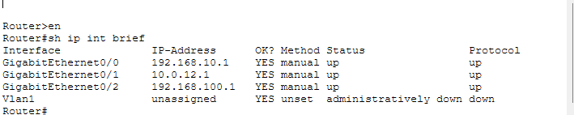

| 장비 | 인터페이스 | IP 주소 | 서브넷 마스크 |
|---|---|---|---|
| Router0 | G0/0 | 192.168.10.1 | 255.255.255.0 |
| Router0 | G0/1 | 10.0.12.1 | 255.255.255.252 |
| Router0 | G0/2 | 192.168.100.1 | 255.255.255.0 |
| Router1 | G0/0 | 192.168.20.1 | 255.255.255.0 |
| Router1 | G0/1 | 10.0.12.2 | 255.255.255.252 |
| Router1 | G0/2 | 10.0.23.1 | 255.255.255.252 |
| Router2 | G0/0 | 192.168.30.1 | 255.255.255.0 |
| Router2 | G0/1 | 10.0.23.2 | 255.255.255.252 |

### 3-3. PC 및 서버 IP 주소

| 장비 | IP 주소 | 할당 방식 |
|---|---|---|
| PC0 (HQ) | 192.168.10.11 | DHCP |
| PC1 (Branch1) | 192.168.20.11 | DHCP |
| PC2 (Branch2) | 192.168.30.11 | DHCP |
| Server0 | 192.168.100.2 | Static IP |

- LAN Subnet Mask: 255.255.255.0
- WAN Subnet Mask: 255.255.255.252
- 각 PC의 기본 게이트웨이는 해당 지점 라우터의 G0/0 주소로 설정
- 서버는 고정 IP를 사용하도록 구성

## 4. 주요 구현 내용

### 4-1. 라우터 인터페이스 구성

각 라우터의 LAN 및 WAN 인터페이스에 IP 주소를 설정하고 인터페이스를 활성화했습니다.

설정 예시(Router0):

```bash
enable
configure terminal

interface gigabitEthernet 0/0
ip address 192.168.10.1 255.255.255.0
no shutdown

interface gigabitEthernet 0/1
ip address 10.0.12.1 255.255.255.252
no shutdown

interface gigabitEthernet 0/2
ip address 192.168.100.1 255.255.255.0
no shutdown
```

인터페이스 확인 명령어:

```bash
show ip interface brief
```

### 4-2. OSPF 동적 라우팅 구성

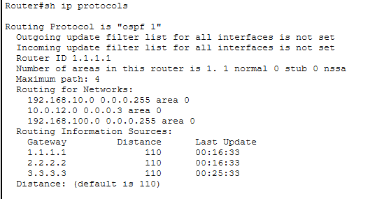

본사와 지사 간 네트워크 경로 정보를 자동으로 교환하기 위해 OSPF를 구성했습니다.

OSPF는 링크 상태 기반의 동적 라우팅 프로토콜로, 라우터 간 경로 정보를 공유하고 최적 경로를 계산합니다.

**OSPF 설정 정보**

| 라우터 | Router ID | Area |
|---|---|---|
| Router0 | 1.1.1.1 | 0 |
| Router1 | 2.2.2.2 | 0 |
| Router2 | 3.3.3.3 | 0 |

**Router0 설정**

```bash
router ospf 1
router-id 1.1.1.1
network 192.168.10.0 0.0.0.255 area 0
network 10.0.12.0 0.0.0.3 area 0
network 192.168.100.0 0.0.0.255 area 0
```

**Router1 설정**

```bash
router ospf 1
router-id 2.2.2.2
network 192.168.20.0 0.0.0.255 area 0
network 10.0.12.0 0.0.0.3 area 0
network 10.0.23.0 0.0.0.3 area 0
```

**Router2 설정**

```bash
router ospf 1
router-id 3.3.3.3
network 192.168.30.0 0.0.0.255 area 0
network 10.0.23.0 0.0.0.3 area 0
```

**OSPF 검증 명령어**

```bash
show ip ospf neighbor
show ip protocols
show ip route
```

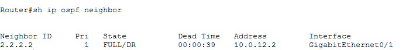

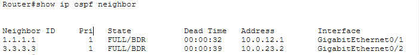

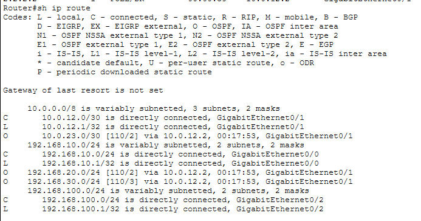

검증 결과:
- OSPF 인접 라우터 확인
- 각 라우터의 Router ID 확인
- 본사에서 지사 네트워크 경로 학습 확인
- 라우팅 테이블에서 O 코드로 표시되는 OSPF 경로 확인

### 4-3. OSPF 트러블슈팅

OSPF 구성 과정에서 Router0의 G0/1 인터페이스 서브넷 마스크가 /24로 잘못 설정되어 Router1과의 OSPF 인접 관계 형성에 문제가 발생했습니다.

Router0의 G0/1 서브넷 마스크를 /30으로 수정하여 해결했습니다.

```bash
interface gigabitEthernet 0/1
ip address 10.0.12.1 255.255.255.252
```

수정 이후 OSPF 인접 관계가 정상적으로 형성되었으며 다른 지점의 네트워크 경로가 라우팅 테이블에 등록되는 것을 확인했습니다.

이를 통해 라우터 간 연결에서 IP 주소뿐 아니라 서브넷 마스크도 정확하게 설정해야 한다는 점을 학습했습니다.

### 4-4. DHCP 자동 IP 할당 구성

각 지점의 PC가 수동 IP 설정 없이 자동으로 주소를 할당받도록 각 라우터에 DHCP Pool을 생성했습니다.

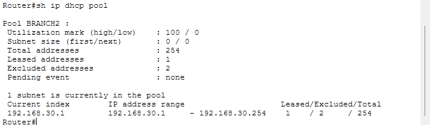

| 라우터 | DHCP Pool | 네트워크 | 기본 게이트웨이 |
|---|---|---|---|
| Router0 | HQ | 192.168.10.0/24 | 192.168.10.1 |
| Router1 | BRANCH1 | 192.168.20.0/24 | 192.168.20.1 |
| Router2 | BRANCH2 | 192.168.30.0/24 | 192.168.30.1 |

각 DHCP Pool에서 .1~.10 주소를 제외하여 게이트웨이 및 관리용 주소로 사용할 수 있도록 구성했습니다.

**Router0 DHCP 설정**

```bash
ip dhcp excluded-address 192.168.10.1 192.168.10.10

ip dhcp pool HQ
network 192.168.10.0 255.255.255.0
default-router 192.168.10.1
dns-server 192.168.100.2
```

**Router1 DHCP 설정**

```bash
ip dhcp excluded-address 192.168.20.1 192.168.20.10

ip dhcp pool BRANCH1
network 192.168.20.0 255.255.255.0
default-router 192.168.20.1
dns-server 192.168.100.2
```

**Router2 DHCP 설정**

```bash
ip dhcp excluded-address 192.168.30.1 192.168.30.10

ip dhcp pool BRANCH2
network 192.168.30.0 255.255.255.0
default-router 192.168.30.1
dns-server 192.168.100.2
```

**DHCP 검증 명령어**

```bash
show ip dhcp pool
show ip dhcp binding
```

검증 결과:
- 3개 라우터의 DHCP Pool 생성
- PC의 IP 주소 자동 할당 확인
- Router2의 DHCP Binding 테이블에서 PC2의 IP 주소 및 MAC 주소 확인

PC2 DHCP 할당 결과:

| 항목 | 결과 |
|---|---|
| IP Address | 192.168.30.11 |
| Client MAC | 00E0.B019.5C43 |
| 할당 방식 | Automatic |

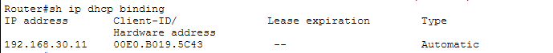

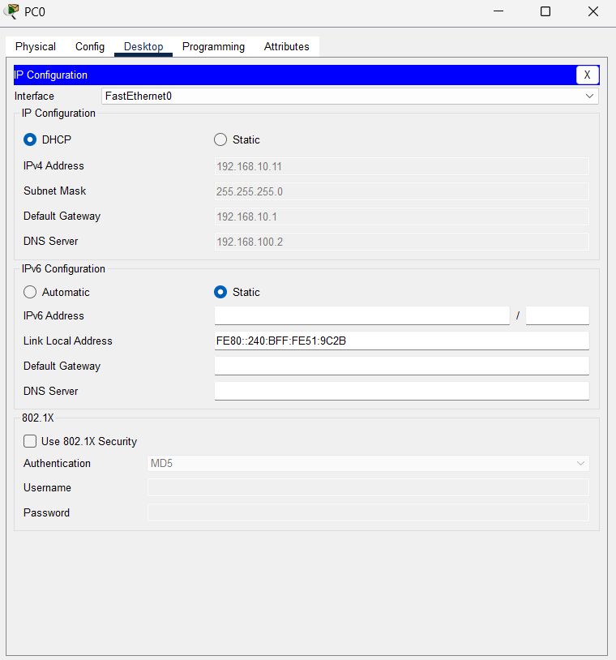

### 4-5. 지점 간 네트워크 통신 검증

OSPF 동적 라우팅과 DHCP 설정이 완료된 이후 각 지점의 PC 간 통신을 Ping 명령어로 검증했습니다.

**Ping 테스트**

```bash
ping 192.168.10.11
ping 192.168.20.11
ping 192.168.30.11
```

검증 결과:
- PC2에서 본사 PC0 통신 성공
- PC2에서 지사1 PC1 통신 성공
- 각 지점 간 통신 정상 작동 확인

초기 테스트에서 본사 PC0의 IP 주소를 192.168.10.10으로 잘못 지정하여 Ping이 실패했습니다. 실제 DHCP 할당 주소인 192.168.10.11로 수정하여 정상 통신을 확인했습니다.

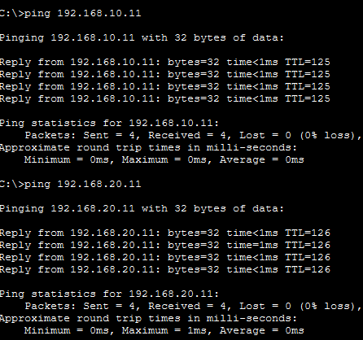

### 4-6. Traceroute를 통한 경로 검증

PC2에서 본사 Router0까지 패킷이 이동하는 경로를 확인하기 위해 Traceroute를 수행했습니다.

**실행 명령어**

```bash
tracert 192.168.10.1
```

**실제 확인된 경로**

| Hop | IP 주소 | 장비 |
|---|---|---|
| 1 | 192.168.30.1 | Router2 |
| 2 | 10.0.23.1 | Router1 |
| 3 | 192.168.10.1 | Router0 |

검증 결과:
- PC2에서 기본 게이트웨이 Router2로 전달
- Router1을 경유하여 Router0에 도달
- 총 3개의 홉을 거쳐 본사 라우터까지 도달하는 경로 확인

이를 통해 OSPF를 통해 학습한 경로가 실제 패킷 전달에 사용되는 것을 확인했습니다.

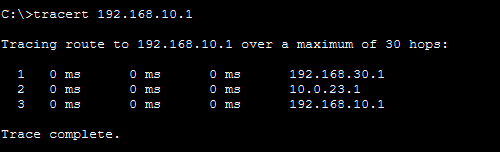

### 4-7. 중앙 서버 및 DNS 서비스 구성

본사 라우터 Router0의 G0/2 인터페이스에 별도의 서버 네트워크를 구성했습니다.

Server0에 고정 IP를 설정하고 DNS 서비스를 활성화하여 각 지점의 PC에서 도메인 이름으로 서버에 접근할 수 있도록 구현했습니다.

**Server0 IP 설정**

| 항목 | 설정값 |
|---|---|
| IP Address | 192.168.100.2 |
| Subnet Mask | 255.255.255.0 |
| Default Gateway | 192.168.100.1 |
| DNS Server | 192.168.100.2 |

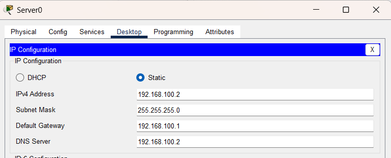

**DNS 설정**

- DNS Service: On
- Domain Name: www.company.local
- Record Type: A
- Address: 192.168.100.2

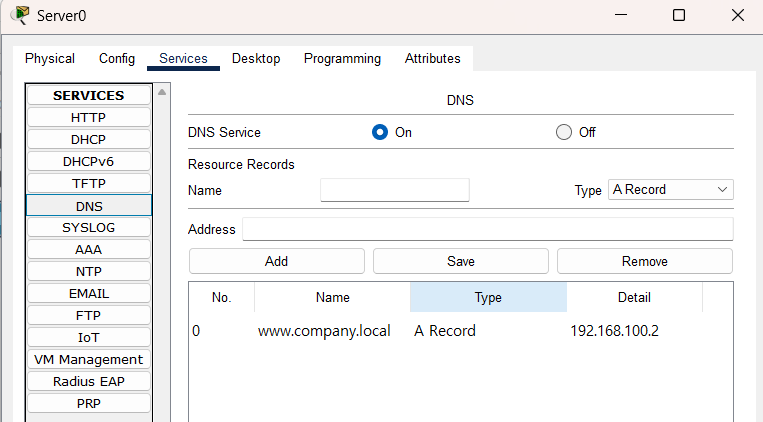

DNS는 사람이 기억하기 쉬운 도메인 이름을 실제 서버 IP 주소로 변환하는 서비스입니다.

각 지점의 DHCP Pool에 DNS 서버 주소를 전달하도록 설정하여 PC가 자동으로 DNS 서버를 사용할 수 있도록 구성했습니다.

### 4-8. HTTP 및 HTTPS 웹 서비스 구성

Server0에서 HTTP 및 HTTPS 서비스를 활성화했습니다.

각 지점의 PC에서 도메인 이름을 입력하여 웹 서버에 접근할 수 있는지 검증했습니다.

**접속 주소**

```text
http://www.company.local
https://www.company.local
```

검증 결과:
- DNS를 통한 도메인 이름 해석 확인
- HTTP 웹 서비스 접속 성공
- HTTPS 서비스 활성화 및 ACL 접근 허용 설정

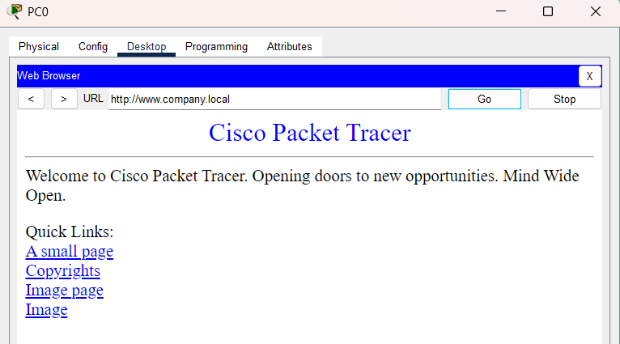

### 4-9. ACL을 활용한 네트워크 접근 제어

지점별 네트워크 접근 권한을 제어하기 위해 Extended ACL을 구성했습니다.

ACL(Access Control List)은 출발지 IP, 목적지 IP, 프로토콜 및 포트 번호를 기준으로 네트워크 트래픽의 허용 또는 차단을 결정하는 기능입니다.

**Branch1 ACL 정책**

| 정책 | 동작 |
|---|---|
| DNS UDP 53 | 허용 |
| DNS TCP 53 | 허용 |
| HTTP TCP 80 | 허용 |
| HTTPS TCP 443 | 허용 |
| Branch1 → Server 일반 트래픽 | 차단 |
| Branch1 → Branch2 | 차단 |
| 기타 트래픽 | 허용 |

**Branch2 ACL 정책**

| 정책 | 동작 |
|---|---|
| DNS UDP 53 | 허용 |
| DNS TCP 53 | 허용 |
| HTTP TCP 80 | 허용 |
| HTTPS TCP 443 | 허용 |
| Branch2 → Server 일반 트래픽 | 차단 |
| Branch2 → HQ | 차단 |
| 기타 트래픽 | 허용 |

**Branch1 ACL 설정**

```bash
ip access-list extended BRANCH1_ACL

permit udp 192.168.20.0 0.0.0.255 host 192.168.100.2 eq 53
permit tcp 192.168.20.0 0.0.0.255 host 192.168.100.2 eq 53
permit tcp 192.168.20.0 0.0.0.255 host 192.168.100.2 eq 80
permit tcp 192.168.20.0 0.0.0.255 host 192.168.100.2 eq 443

deny ip 192.168.20.0 0.0.0.255 192.168.100.0 0.0.0.255
deny ip 192.168.20.0 0.0.0.255 192.168.30.0 0.0.0.255

permit ip any any
```

**Branch2 ACL 설정**

```bash
ip access-list extended BRANCH2_ACL

permit udp 192.168.30.0 0.0.0.255 host 192.168.100.2 eq 53
permit tcp 192.168.30.0 0.0.0.255 host 192.168.100.2 eq 53
permit tcp 192.168.30.0 0.0.0.255 host 192.168.100.2 eq 80
permit tcp 192.168.30.0 0.0.0.255 host 192.168.100.2 eq 443

deny ip 192.168.30.0 0.0.0.255 192.168.100.0 0.0.0.255
deny ip 192.168.30.0 0.0.0.255 192.168.10.0 0.0.0.255

permit ip any any
```

**ACL 적용 및 확인**

Branch1과 Branch2 라우터의 G0/0 인터페이스에 각각 ACL을 Inbound 방향으로 적용했습니다.

```bash
interface gigabitEthernet 0/0
ip access-group BRANCH1_ACL in
```

Branch2에서는 `BRANCH1_ACL` 대신 `BRANCH2_ACL`을 적용했습니다.

확인 명령어:

```bash
show access-lists BRANCH1_ACL
show access-lists BRANCH2_ACL
show ip interface gigabitEthernet 0/0
```

검증 결과:
- 지사별 DNS, HTTP, HTTPS 트래픽 허용
- 지사에서 서버의 허용되지 않은 트래픽 차단
- 지사 간 및 본사 방향의 지정된 트래픽 차단
- ACL Match Count를 통해 실제 규칙 적용 확인

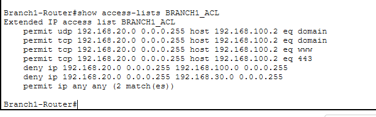

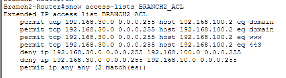

### 4-10. SSH를 활용한 라우터 원격 관리

각 라우터에 SSH(Secure Shell)를 구성하여 네트워크 장비에 원격으로 접속할 수 있도록 구현했습니다.

SSH는 암호화된 통신을 이용하여 원격 장비를 안전하게 관리할 수 있는 프로토콜입니다.

**주요 설정 내용**

- Hostname 설정
- Domain Name 설정
- 로컬 사용자 계정 생성
- RSA 공개키 생성
- SSH Version 2 활성화
- VTY 라인에서 로컬 계정 인증 적용
- Telnet 대신 SSH 접속 허용

**설정 예시**

```bash
hostname HQ-Router
ip domain-name company.local
username admin privilege 15 secret Admin123!

crypto key generate rsa
ip ssh version 2

line vty 0 4
login local
transport input ssh
```

위 설정을 본사 및 두 지사 라우터에 각각 적용했습니다.

**SSH 검증 명령어**

```bash
show ip ssh
```

**PC에서 SSH 접속 테스트**

```bash
ssh -l admin 192.168.10.1
ssh -l admin 192.168.20.1
ssh -l admin 192.168.30.1
```

검증 결과:
- HQ 라우터 SSH 접속 성공
- Branch1 라우터 SSH 접속 성공
- Branch2 라우터 SSH 접속 성공
- SSH Version 2 활성화 확인


### 4-11. OSPF 장애 감지 및 복구 테스트

OSPF의 장애 감지 및 복구 과정을 확인하기 위해 Router1과 Router2 사이의 연결을 일시적으로 차단한 후 복구 테스트를 진행했습니다.

**장애 발생 설정**

Router1의 G0/2 인터페이스를 비활성화했습니다.

```bash
configure terminal
interface gigabitEthernet 0/2
shutdown
```

이후 다음 명령어로 OSPF 이웃 상태와 라우팅 정보를 확인했습니다.

```bash
show ip ospf neighbor
show ip route ospf
```

**네트워크 복구 설정**

```bash
configure terminal
interface gigabitEthernet 0/2
no shutdown
```

인터페이스 복구 이후 OSPF 인접 관계가 다시 형성되는 것을 확인했습니다.

복구 과정에서 다음과 같은 로그를 확인했습니다.

```text
%OSPF-5-ADJCHG:
Nbr 3.3.3.3 on GigabitEthernet0/2
from LOADING to FULL, Loading Done
```

검증 결과:
- 인터페이스 장애 발생 및 OSPF 이웃 상태 변화 확인
- 인터페이스 복구 후 OSPF 인접 관계 재형성
- LOADING에서 FULL 상태로 전환되는 과정 확인
- OSPF 경로 정보 재학습 확인

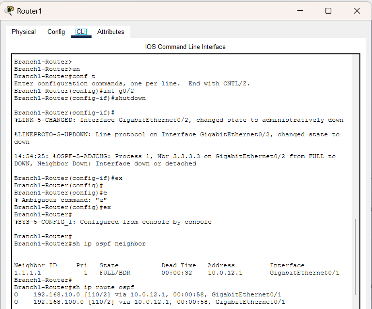

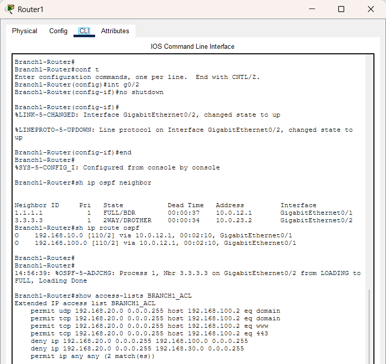

본 테스트는 장애 감지와 링크 복구 이후 라우팅 정보가 다시 수렴하는 과정을 검증한 것입니다. 현재 토폴로지는 HQ-Branch1-Branch2의 직렬 구조이므로 대체 경로를 이용한 자동 우회 테스트는 포함하지 않았습니다.

## 5. 최종 네트워크 검증 결과

| 검증 항목 | 테스트 방법 | 결과 |
|---|---|---|
| 라우터 인터페이스 | `show ip interface brief` | 확인 완료 |
| OSPF 인접 관계 | `show ip ospf neighbor` | 성공 |
| OSPF 경로 학습 | `show ip route` | 성공 |
| OSPF 프로토콜 | `show ip protocols` | 확인 완료 |
| DHCP Pool | `show ip dhcp pool` | 성공 |
| DHCP Binding | `show ip dhcp binding` | 성공 |
| PC IP 자동 할당 | PC IP Configuration | 성공 |
| 본사 ↔ 지사 간 Ping | `ping [IP 주소]` | 성공 |
| 경로 추적 | `tracert 192.168.10.1` | 성공 |
| DNS 도메인 해석 | `www.company.local` | 성공 |
| HTTP 웹 접속 | Web Browser | 성공 |
| HTTPS 서비스 | Server 및 ACL 설정 확인 | 확인 완료 |
| Branch1 ACL | `show access-lists BRANCH1_ACL` | 확인 완료 |
| Branch2 ACL | `show access-lists BRANCH2_ACL` | 확인 완료 |
| SSH 원격 접속 | PC에서 SSH 접속 | 성공 |
| OSPF 장애 복구 | 인터페이스 shutdown/no shutdown | 성공 |

## 6. 주요 확인 명령어

네트워크 구성 및 문제 해결 과정에서 다음 명령어를 활용했습니다.

```bash
show ip interface brief
show ip ospf neighbor
show ip protocols
show ip route
show ip dhcp pool
show ip dhcp binding
show access-lists
show ip ssh
ping [IP 주소]
tracert [IP 주소]
```

## 7. 프로젝트를 통해 학습한 내용

### 7-1. 네트워크 설계 및 IP 주소 관리

- 기업 본사 및 지사 네트워크 토폴로지 설계
- IPv4 주소 체계 및 서브넷 마스크 구성
- /24 및 /30 서브넷의 차이와 활용
- 라우터 인터페이스별 IP 주소 설정
- 기본 게이트웨이의 역할과 패킷 전달 과정 이해

### 7-2. 라우팅 및 네트워크 통신

- OSPF 동적 라우팅 구성 및 경로 학습
- Router ID와 Area 0의 역할 이해
- OSPF Neighbor 상태 및 인접 관계 확인
- Routing Table의 O, C, L 코드 의미 이해
- Ping을 활용한 네트워크 연결 검증
- Traceroute를 통한 패킷 전달 경로 분석

### 7-3. 네트워크 서비스

- DHCP Pool을 활용한 IP 자동 할당
- DHCP Excluded Address를 통한 특정 IP 주소 예약
- DHCP Binding을 통한 IP 및 MAC 주소 확인
- DNS를 통한 도메인 이름과 IP 주소의 변환 과정 이해
- HTTP와 HTTPS 웹 서비스 구성 및 접근 테스트

### 7-4. 네트워크 보안 및 원격 관리

- Extended ACL을 활용한 네트워크 접근 제어
- Source IP, Destination IP, Protocol, Port 기반 트래픽 제어
- TCP와 UDP의 차이 및 서비스별 포트 번호 이해
- ACL Inbound 적용 방향과 규칙 순서 이해
- SSH Version 2 및 RSA 키 기반 원격 관리 구성
- VTY 라인과 로컬 사용자 인증 설정

### 7-5. 트러블슈팅 및 장애 대응

- IP 주소 및 서브넷 마스크 설정 오류 해결
- OSPF 인접 관계 형성 문제 분석
- DHCP IP 할당 및 통신 오류 확인
- DNS 도메인 해석 문제 점검
- ACL Match Count를 활용한 규칙 적용 확인
- 인터페이스 장애 발생 및 복구에 따른 OSPF 재수렴 확인

## 8. 향후 개선 계획

현재 본사 및 지사 간 내부 네트워크 구성, 라우팅, 주소 자동 할당, 서버 서비스, 접근 제어 및 원격 관리 기능을 구현했습니다.

향후 다음 기능을 추가하여 네트워크의 확장성과 운영 관리 역량을 높일 계획입니다.

- NAT/PAT를 통한 외부 네트워크 통신
- 이중화 링크 및 대체 경로 구성
- HSRP를 활용한 게이트웨이 이중화
- VLAN을 추가한 부서별 네트워크 세분화
- Syslog 및 SNMP를 활용한 네트워크 모니터링
- 실제 Cisco 장비 또는 GNS3/EVE-NG 환경에서 추가 실습

## 9. 프로젝트 파일 구조

```text
Network-Portfolio/
└── 02_Enterprise_Network/
    ├── README.md
    ├── Project_02_Enterprise_Network.pkt
    └── Screenshots/
        ├── 01_topology.png
        ├── 02_router0_interface.png
        ├── 03_ospf_config.png
        ├── 04_ospf_neighbor_R0.png
        ├── 04_ospf_neighbor_R1.png
        ├── 05_routing_table.png
        ├── 06_dhcp_pool.png
        ├── 07_dhcp_binding.png
        ├── 08_dhcp_client.png
        ├── 09_ping_test.png
        ├── 10_traceroute.png
        ├── 11_server_ip.png
        ├── 12_dns_record.png
        ├── 13_http_test.png
        ├── 14_branch1_acl.png
        ├── 15_branch2_acl.png
        ├── 16_ssh_test_HQ.png
        ├── 17_ssh_test_Branch1.png
        ├── 18_ssh_test_Branch2.png
        ├── 19_ospf_before_failure.png
        └── 20_ospf_after_recovery.png
```

## 10. 프로젝트 요약

본 프로젝트에서는 기업의 본사와 2개 지사를 연결하는 다중 지점 네트워크를 설계하고 구축했습니다.

OSPF 동적 라우팅을 통해 각 지점의 네트워크 경로를 자동으로 학습하도록 구성했으며, DHCP를 활용하여 각 지점의 PC에 IP 주소를 자동 할당했습니다.

또한 중앙 서버에 DNS, HTTP 및 HTTPS 서비스를 구성하고, ACL을 통해 지점별 네트워크 접근을 제어했습니다. SSH 원격 접속을 구현하여 라우터 관리 기능을 추가했으며, OSPF 장애 및 복구 테스트를 통해 네트워크 장애 대응 과정을 검증했습니다.

**Project:** Enterprise Multi-Site Network Design & Implementation  
**Tool:** Cisco Packet Tracer  
**Focus:** Network Infrastructure / OSPF / DHCP / DNS / ACL / SSH / Troubleshooting
