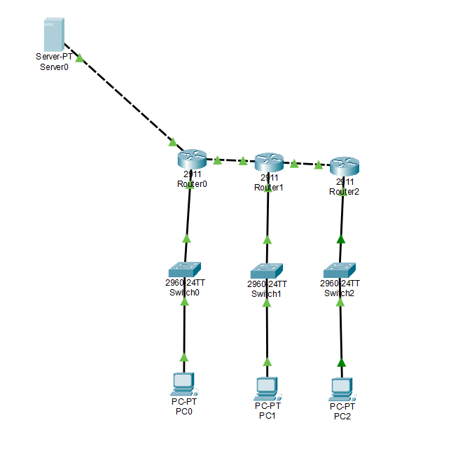

# 기업 본사 및 지사 네트워크 구축
### Enterprise Multi-Site Network Design & Implementation

## 1. 프로젝트 개요

Cisco Packet Tracer를 활용하여 기업의 본사(HQ)와 2개의 지사(Branch1, Branch2)를 연결하는 다중 지점 네트워크를 설계하고 구축한 프로젝트입니다.

각 지점에 독립적인 LAN을 구성하고 OSPF 동적 라우팅을 적용하여 서로 다른 네트워크 간 통신이 가능하도록 구현했습니다.

또한 각 지점의 라우터에 DHCP 서버 기능을 구성하여 PC가 IP 주소를 자동으로 할당받도록 했으며, Ping과 Traceroute를 활용하여 지점 간 통신 및 패킷 전달 경로를 검증했습니다.

- **프로젝트 유형:** 기업 본사 및 지사 네트워크 구축
- **개발 도구:** Cisco Packet Tracer
- **라우터:** Cisco 2911
- **스위치:** Cisco 2960
- **PC:** PC-PT 3대
- **서버:** Server-PT 1대
- **주요 기술:** IPv4, Subnetting, OSPF, DHCP, ICMP, Traceroute

## 2. 네트워크 구성도

본사(Router0)와 2개의 지사(Router1,Router2)를 라우터를 통해 연결하는 구조로 구성했습니다.


                   

       [Router0]          [Router1]          [Router2]
           |                  |                  |
        [Switch0]          [Switch1]          [Switch2]
           |                  |                  |
          PC0                PC1                PC2
           HQ              Branch1            Branch2
```

## 3. 네트워크 IP 설계

### 3-1. 지점별 LAN 네트워크

| 구분 | 네트워크 주소 | 기본 게이트웨이 |
|---|---|---|
| HQ | 192.168.10.0/24 | 192.168.10.1 |
| Branch1 | 192.168.20.0/24 | 192.168.20.1 |
| Branch2 | 192.168.30.0/24 | 192.168.30.1 |
| Server | 192.168.100.0/24 | 192.168.100.1 |

### 3-2. 라우터 인터페이스 IP 주소

| 장비 | 인터페이스 | IP 주소 | 서브넷 마스크 |
|---|---|---|---|
| Router0 | G0/0 | 192.168.10.1 | 255.255.255.0 |
| Router0 | G0/1 | 10.0.12.1 | 255.255.255.252 |
| Router0 | G0/2 | 192.168.100.1 | 255.255.255.0 |
| Router1 | G0/0 | 192.168.20.1 | 255.255.255.0 |
| Router1 | G0/1 | 10.0.12.2 | 255.255.255.252 |
| Router1 | G0/2 | 10.0.23.1 | 255.255.255.252 |
| Router2 | G0/0 | 192.168.30.1 | 255.255.255.0 |
| Router2 | G0/1 | 10.0.23.2 | 255.255.255.252 |

### 3-3. PC 및 서버 IP 주소

| 장비 | IP 주소 | 할당 방식 |
|---|---|---|
| PC0 (HQ) | 192.168.10.11 | DHCP |
| PC1 (Branch1) | 192.168.20.11 | DHCP |
| PC2 (Branch2) | 192.168.30.11 | DHCP |
| Server0 | 192.168.100.2 | Static IP 계획 |

- LAN Subnet Mask: 255.255.255.0
- WAN Subnet Mask: 255.255.255.252
- 각 PC의 기본 게이트웨이는 해당 지점 라우터의 G0/0 주소로 설정

## 4. 주요 구현 내용

### 4-1. 라우터 인터페이스 구성

각 라우터의 LAN 및 WAN 인터페이스에 IP 주소를 설정하고 인터페이스를 활성화했습니다.

설정 예시(Router0):

```bash
enable
configure terminal

interface gigabitEthernet 0/0
ip address 192.168.10.1 255.255.255.0
no shutdown

interface gigabitEthernet 0/1
ip address 10.0.12.1 255.255.255.252
no shutdown

interface gigabitEthernet 0/2
ip address 192.168.100.1 255.255.255.0
no shutdown
```

인터페이스 확인 명령어:

```bash
show ip interface brief
```

### 4-2. OSPF 동적 라우팅 구성


본사와 지사 간 네트워크 경로 정보를 자동으로 교환하기 위해 OSPF를 구성했습니다.

OSPF는 링크 상태 기반의 동적 라우팅 프로토콜로, 라우터 간 경로 정보를 공유하고 최적 경로를 계산합니다.

**OSPF 설정 정보**

| 라우터 | Router ID | Area |
|---|---|---|
| Router0 | 1.1.1.1 | 0 |
| Router1 | 2.2.2.2 | 0 |
| Router2 | 3.3.3.3 | 0 |

**Router0 설정**

```bash
router ospf 1
router-id 1.1.1.1
network 192.168.10.0 0.0.0.255 area 0
network 10.0.12.0 0.0.0.3 area 0
network 192.168.100.0 0.0.0.255 area 0
```

**Router1 설정**

```bash
router ospf 1
router-id 2.2.2.2
network 192.168.20.0 0.0.0.255 area 0
network 10.0.12.0 0.0.0.3 area 0
network 10.0.23.0 0.0.0.3 area 0
```

**Router2 설정**

```bash
router ospf 1
router-id 3.3.3.3
network 192.168.30.0 0.0.0.255 area 0
network 10.0.23.0 0.0.0.3 area 0
```

**OSPF 검증 명령어**

```bash
show ip ospf neighbor
show ip protocols
show ip route
```

검증 결과:
- OSPF 인접 라우터 확인
- 각 라우터의 Router ID 확인
- 본사에서 지사1 및 지사2의 네트워크 경로 학습 확인
- 라우팅 테이블에서 O 코드로 표시되는 OSPF 경로 확인

### 4-3. OSPF 트러블슈팅

OSPF 구성 과정에서 Router0의 G0/1 인터페이스 서브넷 마스크가 /24로 잘못 설정되어 Router1과의 OSPF 인접 관계 형성에 문제가 발생했습니다.

Router0의 G0/1 서브넷 마스크를 /30으로 수정하여 해결했습니다.

```bash
interface gigabitEthernet 0/1
ip address 10.0.12.1 255.255.255.252
```

수정 이후 OSPF 인접 관계가 정상적으로 형성되었으며 다른 지점의 네트워크 경로가 라우팅 테이블에 등록되는 것을 확인했습니다.

이를 통해 라우터 간 연결에서 IP 주소뿐 아니라 서브넷 마스크도 정확하게 설정해야 한다는 점을 학습했습니다.

### 4-4. DHCP 자동 IP 할당 구성

각 지점의 PC가 수동 IP 설정 없이 자동으로 주소를 할당받도록 각 라우터에 DHCP Pool을 생성했습니다.

| 라우터 | DHCP Pool | 네트워크 | 기본 게이트웨이 |
|---|---|---|---|
| Router0 | HQ | 192.168.10.0/24 | 192.168.10.1 |
| Router1 | BRANCH1 | 192.168.20.0/24 | 192.168.20.1 |
| Router2 | BRANCH2 | 192.168.30.0/24 | 192.168.30.1 |

각 DHCP Pool에서 .1~.10 주소를 제외하여 게이트웨이 및 관리용 주소로 사용할 수 있도록 구성했습니다.

**Router0 DHCP 설정**

```bash
ip dhcp excluded-address 192.168.10.1 192.168.10.10

ip dhcp pool HQ
network 192.168.10.0 255.255.255.0
default-router 192.168.10.1
dns-server 192.168.100.2
```

**Router1 DHCP 설정**

```bash
ip dhcp excluded-address 192.168.20.1 192.168.20.10

ip dhcp pool BRANCH1
network 192.168.20.0 255.255.255.0
default-router 192.168.20.1
dns-server 192.168.100.2
```

**Router2 DHCP 설정**

```bash
ip dhcp excluded-address 192.168.30.1 192.168.30.10

ip dhcp pool BRANCH2
network 192.168.30.0 255.255.255.0
default-router 192.168.30.1
dns-server 192.168.100.2
```

**DHCP 검증 명령어**

```bash
show ip dhcp pool
show ip dhcp binding
```

검증 결과:
- 3개 라우터의 DHCP Pool 생성
- PC의 IP 주소 자동 할당 확인
- Router2의 DHCP Binding 테이블에서 PC2의 IP 주소 및 MAC 주소 확인

PC2 DHCP 할당 결과:

| 항목 | 결과 |
|---|---|
| IP Address | 192.168.30.11 |
| Client MAC | 00E0.B019.5C43 |
| 할당 방식 | Automatic |

### 4-5. 지점 간 네트워크 통신 검증

OSPF 동적 라우팅과 DHCP 설정이 완료된 이후 각 지점의 PC 간 통신을 Ping 명령어로 검증했습니다.

**Ping 테스트**

```bash
ping 192.168.10.11
ping 192.168.20.11
ping 192.168.30.11
```

검증 결과:
- PC2에서 본사 PC0 통신 성공
- PC2에서 지사1 PC1 통신 성공
- 각 지점 간 통신 정상 작동 확인

초기 테스트에서 본사 PC0의 IP 주소를 192.168.10.10으로 잘못 지정하여 Ping이 실패했습니다.

실제 DHCP 할당 주소인 192.168.10.11로 수정하여 정상 통신을 확인했습니다.

### 4-6. Traceroute를 통한 경로 검증

PC2에서 본사 Router0까지 패킷이 이동하는 경로를 확인하기 위해 Traceroute를 수행했습니다.

**실행 명령어**

```bash
tracert 192.168.10.1
```

**실제 확인된 경로**

| Hop | IP 주소 | 장비 |
|---|---|---|
| 1 | 192.168.30.1 | Router2 |
| 2 | 10.0.23.1 | Router1 |
| 3 | 192.168.10.1 | Router0 |

검증 결과:
- PC2에서 기본 게이트웨이 Router2로 전달
- Router1을 경유하여 Router0에 도달
- 총 3개의 홉을 거쳐 본사 라우터까지 도달하는 경로 확인

이를 통해 OSPF를 통해 학습한 경로가 실제 패킷 전달에 사용되는 것을 확인했습니다.

## 5. 최종 네트워크 검증 결과

| 검증 항목 | 테스트 방법 | 결과 |
|---|---|---|
| 라우터 인터페이스 | `show ip interface brief` | 확인 완료 |
| OSPF 인접 관계 | `show ip ospf neighbor` | 성공 |
| OSPF 경로 학습 | `show ip route` | 성공 |
| OSPF 프로토콜 | `show ip protocols` | 확인 완료 |
| DHCP Pool | `show ip dhcp pool` | 성공 |
| DHCP Binding | `show ip dhcp binding` | 성공 |
| PC IP 자동 할당 | PC IP Configuration | 성공 |
| 본사 ↔ 지사2 Ping | `ping 192.168.10.11` | 성공 |
| 지사2 ↔ 지사1 Ping | `ping 192.168.20.11` | 성공 |
| 경로 추적 | `tracert 192.168.10.1` | 성공 |

## 6. 주요 확인 명령어

네트워크 구성 및 문제 해결 과정에서 다음 명령어를 활용했습니다.

```bash
show ip interface brief
show ip ospf neighbor
show ip protocols
show ip route
show ip dhcp pool
show ip dhcp binding
ping [IP 주소]
tracert [IP 주소]
```

## 7. 프로젝트를 통해 학습한 내용

- 기업 본사 및 지사 네트워크 토폴로지 설계
- IPv4 주소 체계 및 서브넷 마스크 구성
- /30 서브넷을 활용한 라우터 간 연결
- OSPF 동적 라우팅 구성 및 경로 학습
- DHCP Pool을 활용한 IP 자동 할당
- DHCP Binding을 통한 IP 및 MAC 주소 확인
- Ping을 활용한 네트워크 연결 검증
- Traceroute를 통한 패킷 전달 경로 분석
- 서브넷 마스크 및 IP 주소 오류 해결 경험
- 다중 지점 네트워크의 라우팅 구조 이해

## 8. 향후 개선 계획

현재 본사 및 지사 간 내부 네트워크 구성과 통신 검증을 완료했습니다.

향후 다음 기능을 추가하여 기업 네트워크의 확장성과 보안성을 높일 계획입니다.

- NAT/PAT를 통한 외부 네트워크 통신
- SSH를 활용한 라우터 원격 관리
- ACL을 활용한 네트워크 접근 제어
- 네트워크 장애 상황을 가정한 트러블슈팅
- 네트워크 모니터링 및 로그 관리

## 9. 프로젝트 파일 구조

```text
Network-Portfolio/
└── 02_Enterprise_Network/
    ├── README.md
    ├── Project_02_Enterprise_Network.pkt
    └── Screenshots/
        ├── 01_topology.png
        ├── 02_router_interfaces.png
        ├── 03_ospf_neighbor.png
        ├── 04_ospf_routing_table.png
        ├── 05_ospf_protocols.png
        ├── 06_dhcp_pool.png
        ├── 07_dhcp_binding.png
        ├── 08_dhcp_client.png
        ├── 09_ping_test.png
        └── 10_traceroute.png
```

## 10. 프로젝트 요약

본 프로젝트에서는 기업의 본사와 2개 지사를 연결하는 다중 지점 네트워크를 설계하고 구축했습니다.

OSPF 동적 라우팅을 통해 각 지점의 네트워크 경로를 자동으로 학습하도록 구성했으며, DHCP를 활용하여 각 지점의 PC에 IP 주소를 자동 할당했습니다.

이후 Ping과 Traceroute를 통해 실제 지점 간 통신 및 패킷 전달 경로를 검증했습니다.

**Project:** Enterprise Multi-Site Network Design & Implementation  
**Tool:** Cisco Packet Tracer  
**Focus:** Network Infrastructure / OSPF / DHCP / Routing / Troubleshooting
